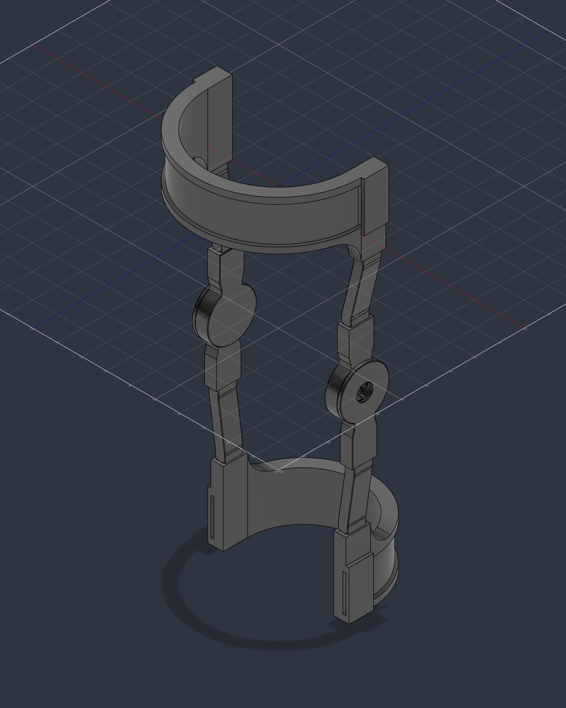

# Fusion 360 model

Parametric Fusion 360 rebuild of the MK-Brace (October 2026). The live design is **Modular Knee Brace** in the Fusion project **Knee brace Design**; the files here are exports of it plus the scripts that build it.



## Files

| Path | What it is |
| --- | --- |
| `Modular-Knee-Brace.f3d` | Fusion archive with the full timeline, user parameters and all 10 parts (*File → Open → Open from my computer*) |
| `Modular-Knee-Brace.step` | Neutral STEP of the whole assembly in its assembled position |
| `stl/` | One binary STL per part, in **millimetres**, in model orientation (as exported) |
| `print/` | **Send this to the printer:** the same STLs on their print faces, plus print settings and quantities ([`print/README.md`](print/README.md)) |
| `scripts/` | Fusion API scripts that rebuild, measure and export the design |

### Parts and print quantities

| Part | STL | Qty | Source |
| --- | --- | --- | --- |
| Top Frame (thigh) | `top-frame.stl` | 1 | Native parametric (`build_frames`) |
| Bottom Frame (calf) | `bottom-frame.stl` | 1 | Native parametric (`build_frames`) |
| Upper Connector | `upper-connector.stl` | **2** | Native (`build_print_parts`) |
| Lower Connector | `lower-connector.stl` | **2** | Native (`build_print_parts`) |
| Inner Hinge | `left-inner-hinge.stl`, `right-inner-hinge.stl` | 1 each | Native (`build_print_parts`) |
| Outer Hinge | `outer-hinge.stl` | **2** | Native (`build_print_parts`) |

### How to print them

| Part | On the bed | Height | Layers at 0.2 / 0.3 mm | Notes |
| --- | --- | --- | --- | --- |
| Inner Hinge | Base face down | 15.6 mm | 78 / 52 | The tab socket roof is a 19.7 mm bridge; the snap post needs no support |
| Outer Hinge | Cap face down | 12.7 mm | 63 / 42 | The tab socket roof is a 19.7 mm bridge; the barb seat narrows at 45° |
| Connectors | On edge, flat profile face down | 19.1 mm | 95 / 64 | No overhangs. Narrow on the bed, so use a brim |
| Frames | Band end down, socket mouths up | 76.2 mm | 381 / 254 | The gussets are the only overhang |

Print one Inner + Outer hinge pair first. It is a small job and proves the fit on your printer before the frames.

## Coordinates and units

- Model units are inches. Y is the leg axis (up), Z points to the front, X is lateral.
- The Top Frame is the assembly origin; the knee (hinge) axis is at (0, −6.0, −0.5) in.

## Frame parameters

Change them in *Modify → Change Parameters*; both frames, their sockets, gussets and strap paths follow.

| Parameter | Default | Meaning |
| --- | --- | --- |
| `top_frame_id` | 5.75 in | Top frame bore (thigh fit) |
| `bottom_frame_id` | 4.50 in | Bottom frame bore (calf fit) |
| `top_frame_half_angle` | 90° | Half the top frame's wrap. 90° squares the sockets to the hinge plane and centres them on the knee axis in Z |
| `bottom_frame_half_angle` | 90° | Half the bottom frame's wrap, same reason |
| `frame_height` | 2.00 in | Band height |
| `frame_wall` | 0.50 in | Band thickness |
| `block_length`, `block_drop` | 1.00 in, 1.00 in | End block length; how far it drops toward the knee (also the gusset radius) |
| `tab_width`, `tab_thickness`, `tab_length` | 0.75, 0.25, 1.00 in | Connector tab |
| `fit_clearance` | 0.01 in | Per side, tab to socket |
| `socket_flare_depth` | 0 in | Optional flared socket mouth; 0 leaves a flat shoulder for the connector to butt against |
| `strap_recess_height`, `strap_recess_depth` | 1.50 in, 0.125 in | Strap recess and strap slot |
| `lip_thickness` | 0.125 in | Strap bridge over each end-block slot |

Rebuild the frames with the scripts after changing the half-angles: changing them in place breaks the strap bridge and slot references.

## Hinge and connector parameters

Read when `build_print_parts` runs, so re-run it after changing them. `hinge_clearance` is the one to tune for your printer.

| Parameter | Default | Meaning |
| --- | --- | --- |
| `hinge_clearance` | 0.016 in (0.41 mm) | Running clearance between hinge parts, radial and axial |
| `hinge_socket_clearance` | 0.012 in (0.30 mm) | Per side, connector tab to hinge socket |
| `hinge_stop_gap` | 0.02 in | Outer arm to extension stop at full extension (stops 1–2° past straight) |
| `hinge_arm_root_width` | 0.85 in | Arm width at the hub; sets the flexion limit (115–120° at this width) |
| `snap_post_radius`, `snap_wall`, `snap_slit` | 0.25, 0.07, 0.05 in | Snap post journal, finger wall, slit width |
| `snap_interference` | 0.03 in (0.76 mm) | How far each finger deflects to pass the mouth |
| `connector_body_thickness` | 0.40 in | Connector body between the tabs |

The SolidWorks originals stay in `cad/solidworks-final/` for reference; [`docs/fusion-rebuild.md`](../../docs/fusion-rebuild.md) has their measurements.

## Scripts

| Script | Does |
| --- | --- |
| `build_frames` | Creates the parameters and both parametric frames in the active design |
| `build_print_parts` | Builds the printable connectors and hinges around the frames |
| `place_original_parts` | Superseded. Copies the original connectors and hinges, which cannot be printed and assembled as designed |
| `measure_part` | Prints size, volume, cylinder diameters and planar-face offsets of every body |
| `export_brace` | Writes the `.f3d`, `.step`, `stl/` and the `docs/images/fusion/` renders back into this repo |
| `orient_for_print.py` | Plain Python, no Fusion needed. Turns `stl/` into the print-oriented `print/` package and checks every mesh is closed. Run after each export |

Run one from Fusion: *Utilities → Add-Ins → Scripts and Add-Ins → + (Script) → select its folder → Run*.

Rebuild from scratch: new design → `build_frames` → `build_print_parts`.

From Claude Code with the Fusion MCP connected, run a repo script by loading the file, so the committed code is what runs:

```python
import importlib.util


def run(_context: str):
    path = r'<repo>\cad\fusion\scripts\build_frames\build_frames.py'
    spec = importlib.util.spec_from_file_location('build_frames', path)
    module = importlib.util.module_from_spec(spec)
    spec.loader.exec_module(module)
    module.run('')
```
